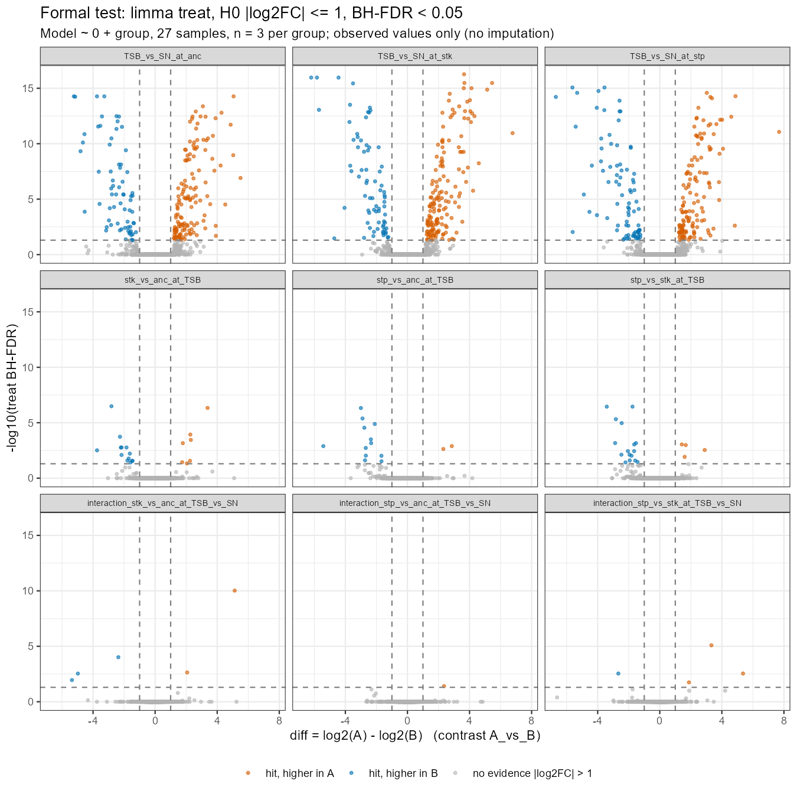
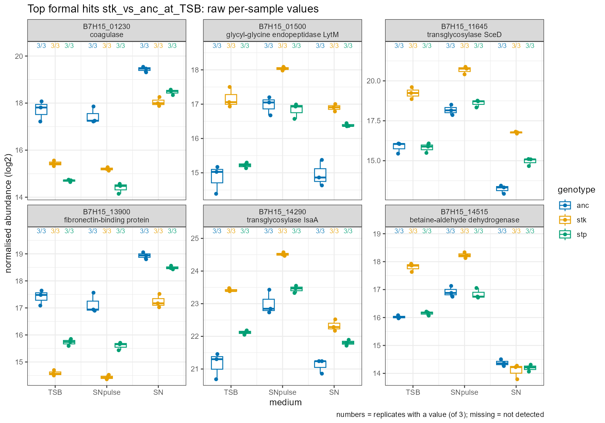

```{r setup}
#| include: false
source("../R/setup.R")
formal_file <- file.path(REPO_ROOT, "data/derived/limma_treat_total_mval.tsv.gz")
if (!file.exists(formal_file)) stop("Run `Rscript scripts/05_formal_test_mval.R` first.")
res  <- read_tsv(formal_file, show_col_types = FALSE)
outd <- file.path(REPO_ROOT, "mval_medi/results/step05_formal_test")
```

## What was decided, and why

Thresholds were fixed by the group on 12 Nov 2026, **before** looking at the
results (rules section 5).

| item | choice |
|---|---|
| model | limma, `~ 0 + group` (9 genotype × medium means), all 27 samples, n = 3 per group |
| sign | every contrast written out as `A - B` (`mval_contrasts()`); `A_vs_B > 0` = higher in A |
| test | `treat(lfc = `r MVAL_LFC`)`: null hypothesis \|log2FC\| ≤ `r MVAL_LFC` |
| hit | Benjamini-Hochberg FDR < `r MVAL_FDR`, within each contrast, tested proteins only |
| tested | ≥ `r MVAL_MIN_OBS` observed values in every group of the contrast; no imputation, NA stays NA |
| batch | none fitted: one acquisition day, run order blocked by group (confounded) |

**Why `treat()` and not "FDR < 0.1, then |log2FC| > 1"?** Filtering the fold
change *after* an ordinary test (H0: log2FC = 0) selects proteins whose
*estimate* is above 1, not proteins with *evidence* that the true change is
above 1, and the FDR no longer refers to the selected list. `treat()` puts the
threshold into the null hypothesis, so the FDR applies to the claim we make
(McCarthy & Smyth 2009, *Bioinformatics* 25:765, PMID 19176553).

## Guardrail checks

```{r checks}
cat(readLines(file.path(outd, "formal_test_checks_mval.txt")), sep = "\n")
```

## Formal hits vs the supplied screen

The supplied screen is the prolfquapp `lm_impute` model with FDR < 0.1 and
|diff| > 1 afterwards. It is kept for comparison only. `screen_lod_imputed` =
screen hits resting on an imputed group mean (presence/absence evidence that
our observed-only test cannot score).

```{r counts}
read_csv(file.path(outd, "hit_counts_mval.csv"), show_col_types = FALSE) |>
  transmute(contrast, tested = n_tested, formal_up, formal_down,
            screen_supplied = screen_hits_supplied, screen_lod_imputed = screen_hits_lod_imputed) |>
  knitr::kable()
```

`formal_up` = higher in the **first** group of the contrast name, `formal_down`
= higher in the **second**. Example: `r explain_contrast("TSB_vs_SN_at_anc")`

## Volcano plots, primary contrasts (TSB and SN)

Dashed lines are at the thresholds of the test (FDR 0.05, |log2FC| 1).



## Raw values behind the top hits (CLAUDE.md rule 4)



## Known-answer check: Stp1 and Stk1

```{r known}
res |>
  filter(locus_tag %in% KEY_PROTEINS$locus_tag[1:2],
         contrast %in% c("stk_vs_anc_at_TSB", "stp_vs_anc_at_TSB")) |>
  left_join(select(KEY_PROTEINS, locus_tag, short_name), by = "locus_tag") |>
  select(short_name, contrast, diff, std.error, FDR, tested, min_obs_in_groups) |>
  knitr::kable(digits = 3)
```

Stk1 has no observed value in `stk`, and Stp1 has only one in `stp`, so neither
mutated protein can be tested against its own mutant here (`tested = FALSE`).
Their absence is presence/absence evidence, not a fold change. Stk1 is
strongly lower in `stp` (a formal hit): remember that the `stp` strain also
lacks most of the kinase (polar effect, CLAUDE.md).

## Limitations

- n = 3 per group; 33 contrasts, each with its own BH family. No correction
  across contrasts.
- Proteins missing from a whole group are not tested (see `tested`); use the
  supplied `lod_imputed` rows for those, as presence/absence only.
- Run order is confounded with group, so instrument drift cannot be excluded.

## Session info and AI use

Code, checks and this report were drafted with Claude Code (Anthropic); the
thresholds were chosen by the group. A group member must check every number.

```{r session}
sessionInfo()
```
